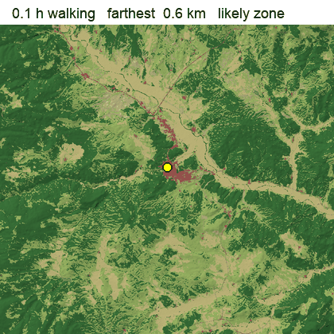
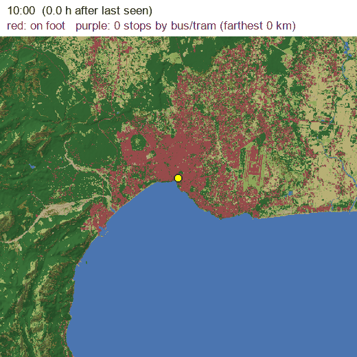
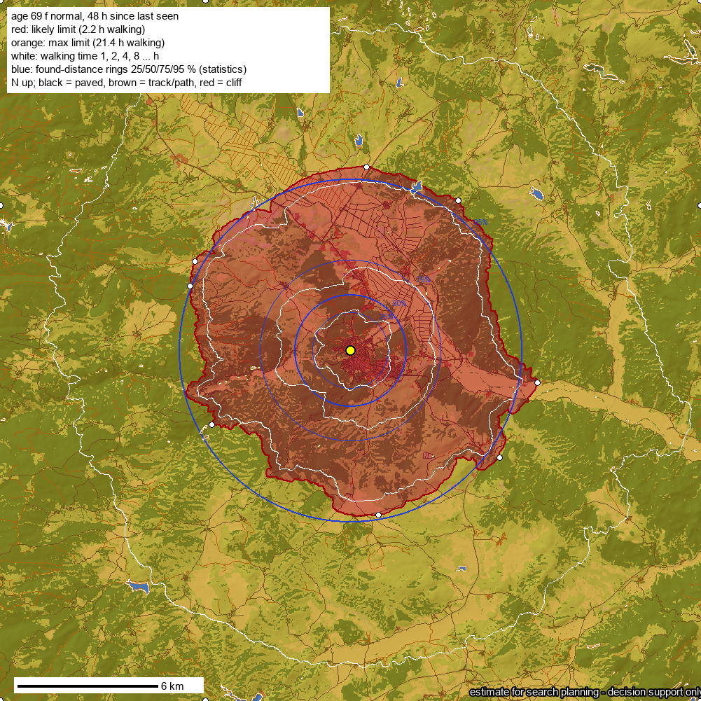
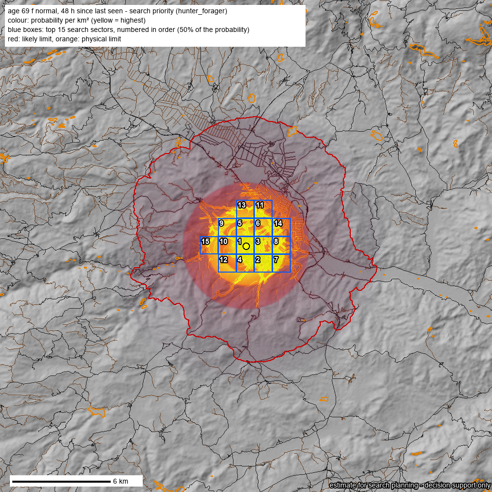
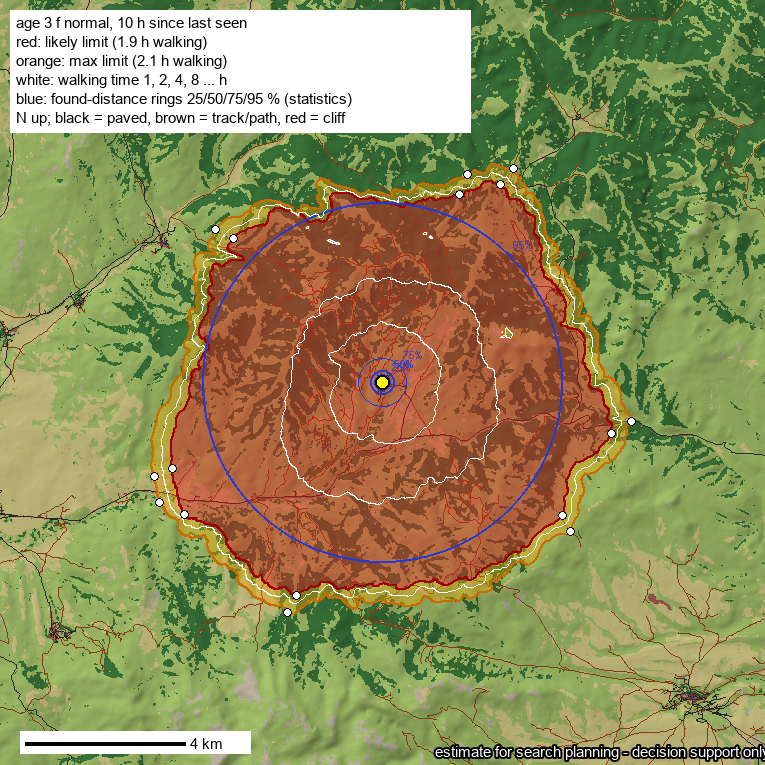
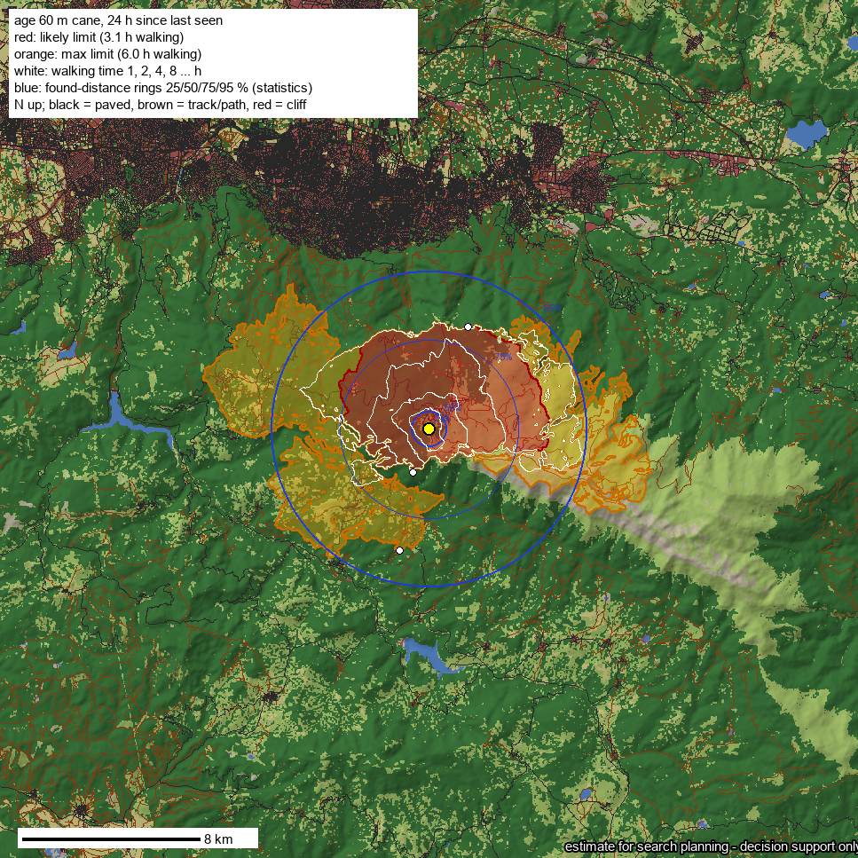
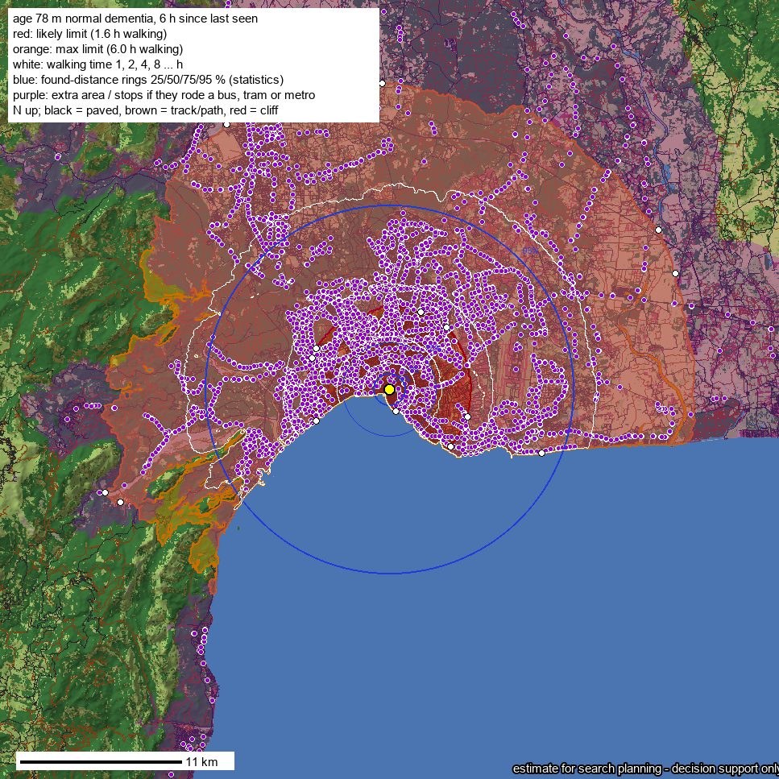

<h1 align="center">sar-sleuth</h1>

<p align="center"><b>How far could a missing person have gone, and where should the search start?</b><br>
Terrain-aware reach maps, search priority and team sectors for search and rescue. Forests, mountains and cities, with real bus and metro timetables.</p>

<table align="center">
<tr>
<td align="center"><br><sub><b>Countryside:</b> 69-year-old woman, Boyabat (Sinop): the area she could reach on foot, hour by hour</sub></td>
<td align="center"><br><sub><b>City:</b> 78-year-old man with dementia, Antalya: walking zone (red) plus bus/tram stops he could reach (purple) as the clock runs</sub></td>
</tr>
</table>

Give it **where the person was last seen**, **when**, and **who they are**: age, sex, fitness, a limp or cane, dementia, a small child, a mushroom picker and so on. It returns:

- **Reach on foot over the real terrain:** slopes, forest, scrub, rivers, cliffs, roads and paths, day and night.
- **A likely zone** calibrated on solved cases, and the **physical limit**.
- **Found-distance rings** from published lost-person statistics.
- **A probability map** and **numbered search sectors**, with a GPX file per team.
- **In cities, public transport:** where they could be if they boarded a bus, tram or metro, from the real timetable.
- **Weather** over the missing hours, with warnings for cold, rain, snow and heat.
- **The farthest point in any direction** ("if he went north…") and the walking route to it.

It is a [Claude Code](https://claude.com/claude-code) agent skill: ask in plain language and the agent runs the scripts. The scripts also work on their own from the command line. **No API keys:** every data source is open.

> Built as **decision support** for search and rescue teams. It does not replace local knowledge or what teams learn in the field.

---

**Contents:** [Quick start](#quick-start) · [Examples](#examples) · [Output](#output) · [How it works](#how-it-works) · [Accuracy](#accuracy) · [Data sources](#data-sources) · [Limits](#limits) · [Contributing](#contributing) · [References](#references)

---

## Quick start

You only need [uv](https://docs.astral.sh/uv/); dependencies install on the first run.

```bash
git clone https://github.com/mstkyvz/sar-sleuth && cd sar-sleuth

uv run skills/sar-sleuth/scripts/reach.py \
  --at 41.4690,34.7672 --since 2026-10-10T08:00+03:00 --hours 48 \
  --age 69 --sex f --category forager --out out/boyabat
```

**Person options:**
- `--age`, `--sex m|f`, `--fitness low|normal|high`
- `--mobility normal|limp|cane|walker`
- `--injured`, `--dementia`, `--can-run yes|no`
- `--category forager|hunter|hiker|autism|despondent|…` (by default it is chosen from the age and flags)

**Where and when:**
- `--toward N --toward S`: farthest point and route in those directions. Turkish `K G D B` also work.
- `--transit auto|yes|no`, `--gtfs <zip url>`: public transport.
- `--roads auto|overture|overpass|none`
- `--conditions DAYS`: Sentinel-2 snow and flood check.

With Claude Code, copy `skills/sar-sleuth` into `~/.claude/skills/` and just ask, for example:
*"A 3-year-old has been missing for 10 hours near Söbeçimen village, Çayıralan. Where should we look first?"*

---

## Examples

All examples, with their maps and data files, are in [`examples/`](examples/).

### 1. Mushroom picker in the forest: 2, 3 and 5 days

> **Q:** A 69-year-old woman went mushroom picking near Boyabat, Sinop and is missing. How far could she get in 2, 3 and 5 days, and where should we look?

| Time missing | **Likely zone** (search first) | Physical limit |
|---|---|---|
| 2 days | farthest ~8 km, median 4.9 km (~150 km²) | 71 km on foot |
| 3 days | same | 95 km on foot |
| 5 days | same | 139 km on foot |

**Why the likely zone does not grow with days:** in solved cases people walk for about 1.5–3 hours, then stop (stuck, exhausted, fallen).

**Published statistics for foragers and hunters:** 50 % are found within 2.4 km, 75 % within 3.9 km and 95 % within 7.4 km.

**Weather:** 11–19 °C, dry, so no warnings.

<table align="center"><tr>
<td align="center"><br><sub>Reach: red likely zone, orange physical limit, blue statistics rings, white hourly walking lines</sub></td>
<td align="center"><br><sub>Search priority: probability per km² (yellow = highest) and the first 15 numbered sectors</sub></td>
</tr></table>

The sectors follow paths, stream beds and the edge of the village. That is where people of this category are usually found. `gpx/sector_01.gpx` … go straight to the teams' handheld GPS units.

### 2. Toddler on a high pasture at night

> **Q:** A 3-year-old girl wandered off a yayla (high summer pasture) at 20:15. Where could she be by morning?

- **Likely zone:** up to 1.9 hours of walking for a 3-year-old, which reaches at most 6 km. The median distance of the cells in the zone is 3.7 km. The physical limit by morning is 6.3 km.
- **Statistics rings for children aged 1–3:** 50 % are found within 0.3 km, 75 % within 0.6 km and 95 % within 4.5 km. Search outward from the point, ring by ring.
- **Where children this age are found:** they tend to shelter in small spaces and fall asleep. The probability map raises structures, paths and stream hollows close to the point.

<p align="center"></p>

### 3. Direction: "if he walked north…"

> **Q:** A 60-year-old man with a cane went missing at this point on Uludağ. If he walked north or south, how far could he get?

```
farthest point by direction (straight km / walking-route km):
     N: likely 4.9/5.5 km | max 4.9/5.5 km
     S: likely 2.1/2.4 km | max 5.6/8.5 km
```

- **North:** about 5 km. Beyond that, the steep slope down to Bursa is impassable with a cane.
- **South:** the steep face of the main ridge stops him at about 2 km.
- **Routes:** each direction's walking route is in `reach.geojson`.

<p align="center"></p>

### 4. City: walking the streets, and buses, trams, metro

> **Q:** A 78-year-old man with dementia was last seen at 10:00 in central Antalya. Where could he be?

In built-up areas (and for ages 7+), the timetable of the missing hours is used:

1. The person walks to a stop within their walking budget.
2. They board a vehicle that leaves after they arrive.
3. They ride, change at nearby stops, and walk on from where they get off.

```
transit: 3894 stops reachable by vehicle; with transit the likely zone reaches 32.8 km
    30.2 km  GÖYNÜK ADNAN MENDERES CAD-3  arrive 2026-10-13 11:14  (walked 0.11 h)
    28.6 km  KEMER SAKIP SABANCI CD-4     arrive 2026-10-13 11:27  (walked 0.07 h)
```

<p align="center"></p>

On foot, his likely zone reaches about 6 km (red). If he boarded a bus, he could have been 30 km away in Kemer by 11:27. The stops and line ends are the places to check: ask drivers and look at CCTV.

**Timetables:**
- **Automatic:** found in the [Mobility Database](https://mobilitydatabase.org) catalog (about 6,700 GTFS feeds worldwide, no key). In Türkiye that includes Antalya, Adana, Gaziantep, Erzurum, Kocaeli, Ordu, Düzce, Çanakkale, Muğla and İzmir metro/tram. Cyprus, Israel and Athens are covered too.
- **Manual:** any other city can be added with `--gtfs <zip url>`, for example İstanbul İETT from data.ibb.gov.tr.

---

## Output

Every run writes to `--out`:

| File | Contents | Open with |
|---|---|---|
| `reach.png` | Reach map: likely zone, physical limit, statistics rings, hourly lines, farthest points, transit | any image viewer |
| `priority.png` | Probability heat map and the top 15 numbered sectors | any image viewer |
| `reach.geojson` | All lines, rings, farthest points and routes, reachable stops | Google Earth, QGIS, geojson.io, OsmAnd / Locus |
| `sectors.csv` / `sectors.geojson` | Every sector: rank, POA (share of the probability), cumulative POA, area, bounds | spreadsheet, GIS |
| `gpx/sector_NN.gpx` | Boundary of each top sector | Garmin, phone GPS apps |
| `reach.json` | Every input and parameter, budgets, areas, distances per direction, transit stops with arrival times, weather and warnings | text editor, other tools |
| `time.npy`, `prob.npy`, `time_transit.npy`, `grid.json` | Walking hours and probability per grid cell | Python |

The agent's answer is short. It gives the likely distance and area, the statistics rings, the first sectors, any weather warnings and, in cities, the stops to check. It also says which starting point it used and what would change the answer.

---

## How it works

```
 person: age, sex, fitness, cane, dementia…        last seen point + time
                │                                             │
                ▼                                             ▼
   walking speed, slope sensitivity,                 daylight / darkness (sun position),
   steepest slope, can they run                      weather (Open-Meteo)
                │                                             │
                └──────────────┬──────────────────────────────┘
                               ▼
     terrain: elevation (AWS Terrain Tiles) + land cover (ESA WorldCover, 10 m)
            + roads and paths (Overture / OpenStreetMap) + snow / floods (Sentinel-2)
                               │
                               ▼
     speed of every step = walking slope (up ≠ down) × hill slope × ground × person
     → shortest walking time to every cell (16-neighbour grid, Dijkstra)
     → in cities: + bus / tram / metro timetables (GTFS, Connection Scan)
                               │
                               ▼
     LIKELY ZONE   calibrated walking cap per group (solved cases)
     LIMIT         physical: fatigue over days, night, moving hours per day
     RINGS         published found-distance statistics per category and terrain
     PRIORITY      rings × walking time × paths, drainages, buildings, downhill
     SECTORS       ranked by probability per km², GPX for teams
```

- **Speed on terrain:** Wood et al. (2023) fitted their model on 88,000 km of GPS tracks. Uphill and downhill are costed separately, along with hill slope, path type and vegetation.
- **Walking speed by age and sex:** Bohannon & Andrews (2011), 23,000 people; children use paediatric norms.
- **Person:**
  - A limp, cane or walker cuts speed and makes steep ground impassable.
  - Slopes cost more for elderly people and small children.
  - Someone who can run, runs in the first minutes.
- **Barriers:** lakes, wide rivers and cliffs block the way; bridges pass. Fresh snow and floods come from the clearest Sentinel-2 scene in the 14 days before.

Every number, with its source, is in [`skills/sar-sleuth/data/speed_model.json`](skills/sar-sleuth/data/speed_model.json) and [`distance_stats.json`](skills/sar-sleuth/data/distance_stats.json). Values not yet backed by data are marked **ASSUMPTION**.

---

## Accuracy

The model was tested on **70 solved cases**: 27 from Türkiye, the rest from the US, Greece, Spain, Australia, Israel, Cyprus and other countries ([`data/cases/`](skills/sar-sleuth/data/cases/): names and source links removed, so the people cannot be identified). Roads were on for the test. When a source gave only a distance, the walking time was taken in the *median* direction, not the easiest one.

| Measure | Result |
|---|---|
| Found point inside the **physical limit** | 70 of 71 (99 %) |
| Found point inside the **likely zone**, leave-one-out (each case tested with values fitted without it) | **71 %** (target 75 %) |
| …children 0–6 / 7–15 | 71 % (n=21) / 73 % (n=11) |
| …65+ / dementia | 72 % (n=18) / 71 % (n=14) |
| …adults 16–64 | 67 % (n=6): too few cases, the weakest group |
| Geographic hold-out: fit on international cases → test on Türkiye | 51 % (n=43) |
| Geographic hold-out: fit on Türkiye → test on international | 93 % (n=27) |

**Main finding:** a found person's walking time does **not** depend on how long they were missing (correlation −0.01 over 4–250 h). Missing for 8 hours or 100, people are mostly found within about 1.5–3 hours of walking. They walk, then stop. So the likely zone is a capped walking budget per group, and it does not grow with days.

**Türkiye vs elsewhere:** the Turkish cases were found farther out, in walking time, than the international ones. There are two possible reasons:
- Turkish news reports rounder or by-road distances.
- People behave differently, or the terrain is different.

This data cannot separate the two. The caps are fitted on all cases together, so in Türkiye the likely zone may still be somewhat tight. When in doubt, search the orange band as well.

**Not validated yet:** the probability map and the sector ranking. Their attractor weights follow published shares but are assumptions until more cases with an exact found point exist.

Re-fit with `calibrate.py fit <dir> --write` whenever cases are added (see [Contributing](#contributing)).

---

## Data sources

All open, no account or key needed.

| Data | Provider | Used for | Licence |
|---|---|---|---|
| Elevation | AWS Terrain Tiles (Terrarium) | slopes, cliffs, drainages, hillshade | open (Mapzen / sources listed by AWS) |
| Land cover, 10 m | ESA WorldCover 2021 | forest, scrub, grass, water, built-up | CC BY 4.0 |
| Roads and paths | Overture Maps (S3), fallback OpenStreetMap Overpass | fast ground, bridges | ODbL |
| Current snow and water | Copernicus Sentinel-2 L2A via Element84 Earth Search | snow cover, floods before the event | Copernicus free and open |
| Weather | Open-Meteo | cold, rain, snow and heat warnings | CC BY 4.0 |
| Timetables | Mobility Database catalog → city GTFS feeds | buses, trams, metro | per feed (listed in `reach.json`) |
| Found-distance statistics | UK Missing Person Behaviour Study, Koester / ISRID, Australian study, and others | rings and probability | quoted as facts with citation |

---

## Limits

- **Reach, not prediction:** the zones show where a person *could* be. The probability map is a guide for ordering the search.
- **Grid resolution:** cells are 25–400 m. Small streams, fences, a single steep step and paths missing from the maps are not seen.
- **Walking only, plus public transport:** rides in private cars, taxis, boats or hitchhiking are outside the model.
- **Statistics vs news cases:** cases from the news were found farther out than the published statistics suggest. Near finds rarely make the news, and reported distances are rounded.
- **Adults 16–64:** only 6 cases so far, so this group's likely zone is the least reliable.
- **Türkiye:** the likely zone may be tight for Turkish cases (geographic hold-out 51 %; see [Accuracy](#accuracy)).
- **Assumed factors:** the vegetation factors, night behaviour and attractor weights are **assumptions** until more cases with exact found points are available.

## Contributing

**The most valuable contribution is a solved case:**
- where the person was last seen (a point)
- where they were found (a point, or the distance)
- how long they were missing
- age, sex and condition
- whether they were found alive

Add it to [`skills/sar-sleuth/data/cases/`](skills/sar-sleuth/data/cases/) in the same schema. **Never include names, and no links that name the person.** Then re-run:

```bash
uv run skills/sar-sleuth/scripts/calibrate.py run skills/sar-sleuth/data/cases/*.json --out calib/ --max-cells 300 --jobs 4
uv run skills/sar-sleuth/scripts/calibrate.py score calib/
uv run skills/sar-sleuth/scripts/calibrate.py fit calib/ --write    # caps + leave-one-out + geographic hold-out
```

Tests: `cd skills/sar-sleuth && uv run -q --with numpy --with scipy --with pillow --with scikit-image --with rasterio --with pandas python -m unittest discover -s tests`

## References

- Wood, Mackaness, Simpson, Armstrong (2023). *Improved prediction of hiking speeds using a data driven approach.* arXiv:2303.16065
- Bohannon & Andrews (2011). *Normal walking speed: a descriptive meta-analysis.* Physiotherapy 97:182–189
- Perkins, Roberts, Feeney (2011). *The UK Missing Person Behaviour Study.* Centre for Search Research
- Koester (2008). *Lost Person Behavior*; Koester (2025) ICAR LPB updates
- Twardy, Koester, Gatt (2006). *Missing person behaviour: an Australian study*
- Doke (2012). *Analysis of search incidents and lost person behavior in Yosemite National Park*
- Dibbelt, Pajor, Strasser, Wagner (2018). *Connection Scan Algorithm.* ACM JEA

## License

Code: [MIT](LICENSE).

The data the tool downloads keeps its own licence. Maps and files made with it should credit:
- © OpenStreetMap contributors / Overture Maps Foundation (ODbL)
- ESA WorldCover 2021 (CC BY 4.0)
- Copernicus Sentinel-2 data
- Open-Meteo (CC BY 4.0)
- the GTFS feed providers listed in `reach.json`

The found-distance statistics are quoted as facts with their sources in [`distance_stats.json`](skills/sar-sleuth/data/distance_stats.json).

The software comes **without warranty**. It produces estimates for search planning and does not replace professional search and rescue judgement.

